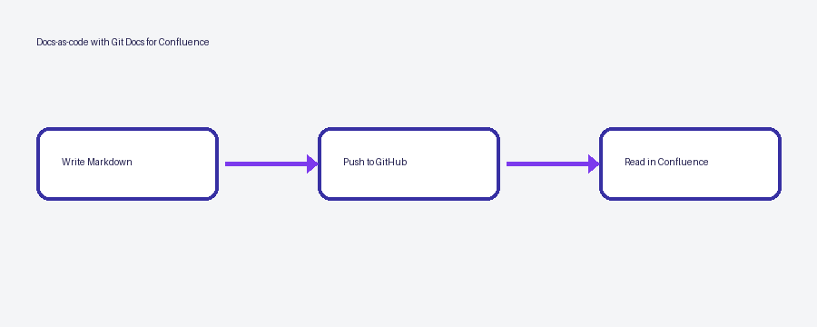

# Acme Platform Handbook

Welcome. This handbook is written in Markdown next to the code and published to
Confluence automatically on every change.

## Where to start

| If you want to… | Read |
|---|---|
| Run the platform locally | [Getting started](getting-started.md) |
| Ship a change to production | [Deploying](guides/deploying.md) |
| Understand how it fits together | [Architecture](architecture/README.md) |
| Fix something that broke | [Troubleshooting](guides/troubleshooting.md#common-problems) |

> [!TIP]
> Every page ends with the commit that last changed it and who made it. Edit the
> Markdown in GitHub rather than the page in Confluence.

## Ownership

The **Platform team** owns this handbook. Questions go to `#platform` on Slack.
