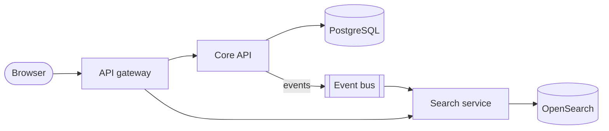

# Architecture

The platform is three services behind one gateway. This page is the overview; the
[data model](data-model.md) has the detail.

## Services

| Service | Language | Owns |
|---|---|---|
| API gateway | TypeScript | Authentication, routing, rate limits |
| Core API | TypeScript | Accounts, projects, billing |
| Search service | Go | Indexing and queries |

## Design principles

1. **One owner per table.** Only the Core API writes to PostgreSQL.
2. **Events, not calls.** Services learn about changes from the event bus.
3. **Fail closed.** A missing permission is a denial, never a default.

> [!IMPORTANT]
> Changes that cross a service boundary need an architecture review. Open an issue
> with the `architecture` label before you start.
