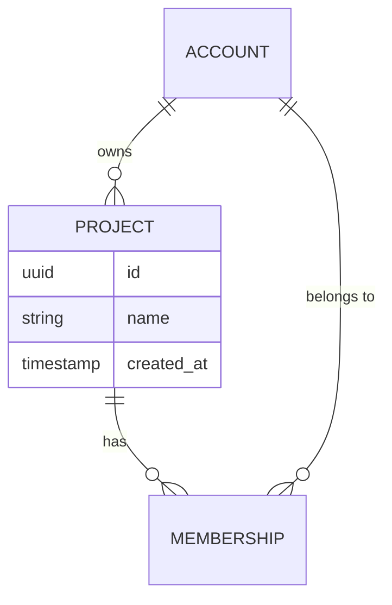

# Data model

The Core API owns these tables. See the [architecture overview](README.md) for how
other services read them.



## Conventions

- Primary keys are UUID v7, generated by the application.
- Every table has `created_at` and `updated_at`, maintained by triggers.
- Soft deletes use a `deleted_at` column; nothing is hard-deleted within 30 days.

## Migrations

```sql
-- migrations/0042_add_project_archived.sql
ALTER TABLE project ADD COLUMN archived_at timestamptz;
CREATE INDEX project_archived_idx ON project (archived_at) WHERE archived_at IS NOT NULL;
```

> [!WARNING]
> Never edit a migration that has been released. Add a new one instead.
